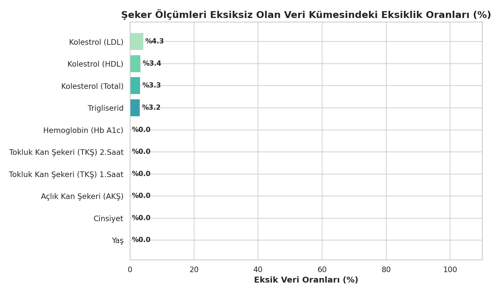
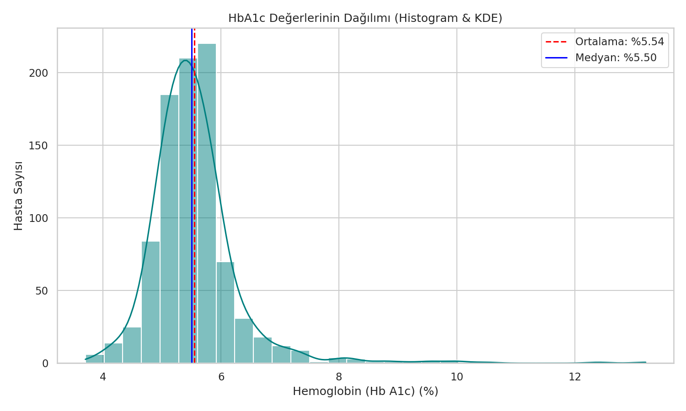
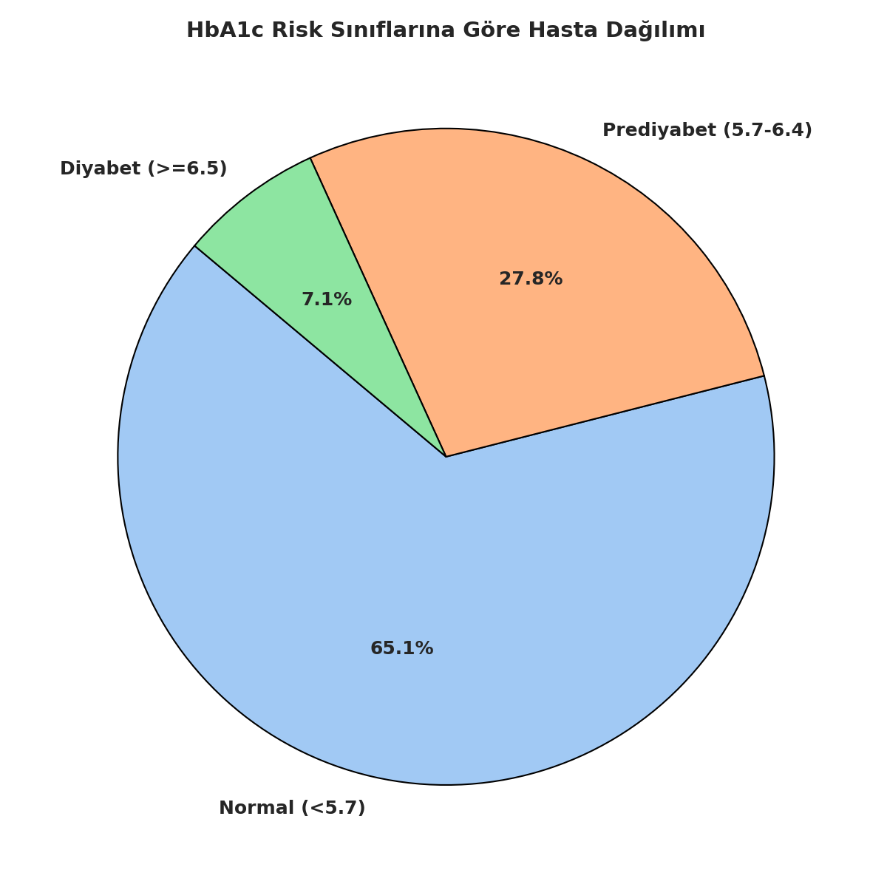
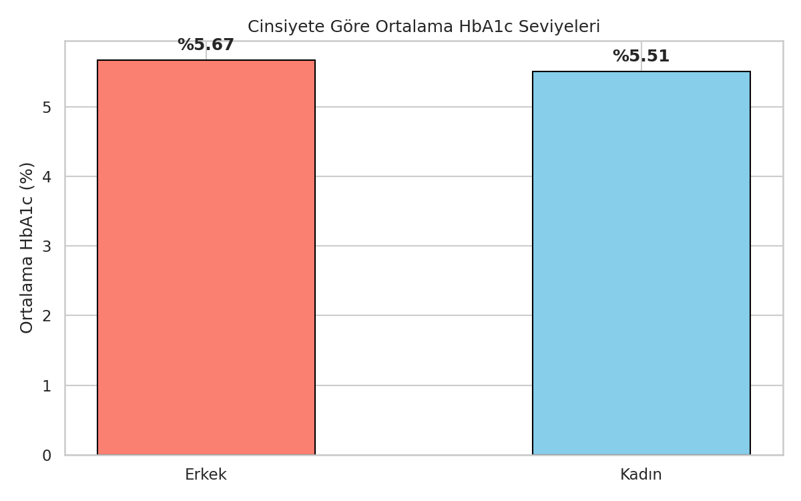
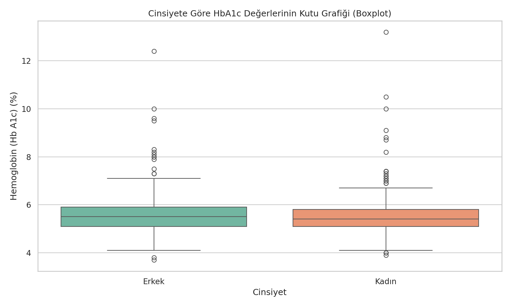
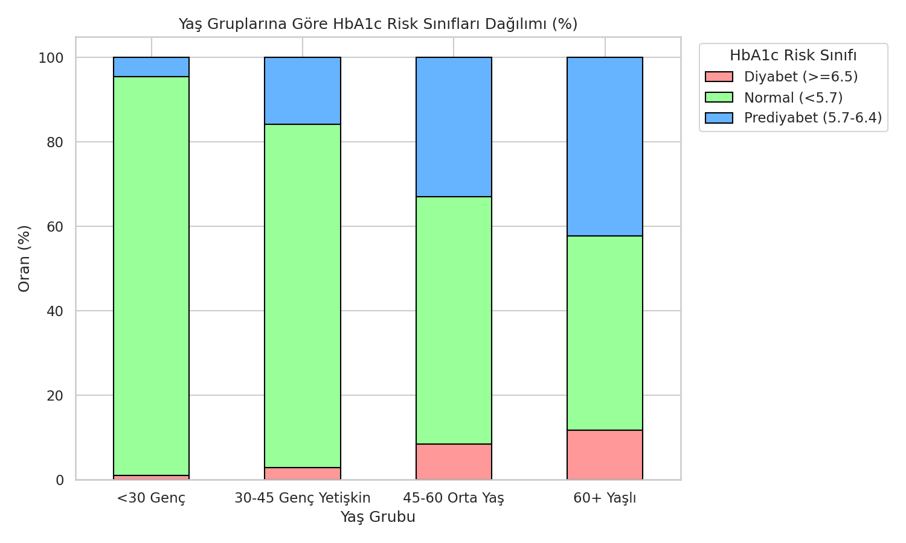
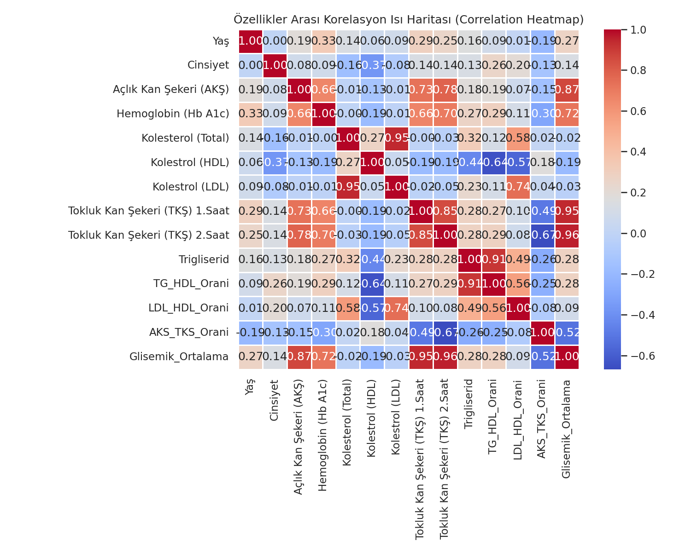

# 📊 Diyabet Veri Seti Analiz Raporu
Bu rapor, temizlenmiş ve şeker parametreleri eksiksiz doldurulmuş olan veri setine ait demografik, klinik ve istatistiksel analizleri içermektedir.

*   **Toplam Satır Sayısı:** 902
*   **Toplam Sütun Sayısı:** 16

---

## 🗂️ 1. Eksik Veri (Null) Analizi ve Veri Filtreleme Aşamaları
Bu çalışma kapsamında veri seti iki aşamalı bir temizleme ve filtreleme sürecinden geçirilmiştir:

### Veri Temizleme ve Eleme Aşamaları Tablosu:
| Aşama | Uygulanan Filtre | Elenen Satır Sayısı | Kalan Satır Sayısı |
| :--- | :--- | :---: | :---: |
| **Başlangıç** | Orijinal Ham Veri Seti | - | 43,460 |
| **1. Aşama** | Şeker Ölçümleri Eksik Olanların Elenmesi (AKŞ, TKŞ 1, TKŞ 2, HbA1c null/0) | 42,518 | 942 |
| **2. Aşama** | Lipid Paneli ve Yaş Değerleri Eksik Olanların Elenmesi (Kolesterol, HDL, LDL, TG, Yaş null) | 40 | 902 |

*Nihai veri setinde (902 satır) hiçbir sütunda eksik veya boş değer kalmamıştır.*

### 1. Aşama Sonrası Şeker Ölçümleri Eksiksiz Olan Veri Kümesindeki Eksiklik Oranları (942 Satır):
| Değişken Adı | Eksik Hücre Sayısı | Oran (%) |
| :--- | :---: | :---: |
| Yaş | 0 | %0.0 |
| Cinsiyet | 0 | %0.0 |
| Açlık Kan Şekeri (AKŞ) | 0 | %0.0 |
| Tokluk Kan Şekeri (TKŞ) 1.Saat | 0 | %0.0 |
| Tokluk Kan Şekeri (TKŞ) 2.Saat | 0 | %0.0 |
| Hemoglobin (Hb A1c) | 0 | %0.0 |
| Kolesterol (Total) | 31 | %3.3 |
| Kolestrol (HDL) | 32 | %3.4 |
| Kolestrol (LDL) | 40 | %4.3 |
| Trigliserid | 30 | %3.2 |

---

## 📈 2. HbA1c Dağılımı ve Risk Sınıfları
HbA1c değerleri, hastaların glisemik kontrol seviyelerini belirlemede en önemli parametredir.

*   **Ortalama HbA1c:** %5.54
*   **Medyan HbA1c:** %5.50
*   **En Düşük HbA1c:** %3.70
*   **En Yüksek HbA1c:** %13.20

### HbA1c Risk Sınıfları Dağılımı (ADA Kriterlerine Göre)
Amerikan Diyabet Birliği (ADA) standartlarına göre yapılan gruplandırma sonuçları aşağıdaki gibidir:
*   **Normal:** < %5.7
*   **Prediyabet (Gizli Şeker):** %5.7 - %6.4
*   **Diyabet (Şeker Hastalığı):** >= %6.5

| Risk Sınıfı | Hasta Sayısı | Oran (%) | Ortalama AKŞ (mg/dL) | Ortalama TKŞ 2.Saat (mg/dL) |
| :--- | :---: | :---: | :---: | :---: |
| Normal | 587 | %65.1 | 89.5 | 97.3 |
| Prediyabet | 251 | %27.8 | 100.0 | 123.4 |
| Diyabet | 64 | %7.1 | 149.6 | 218.1 |

---

## 👥 3. Cinsiyet Analizi
Veri setinde cinsiyete bağlı olarak şeker metabolizması parametrelerinin dağılımı incelenmiştir.

*   **Kadın Hasta Sayısı:** 707 (%78.4)
*   **Erkek Hasta Sayısı:** 195 (%21.6)
 
### Cinsiyet Temelli Klinik İstatistikler
| Cinsiyet | Ortalama Yaş | Ortalama HbA1c (%) | Ortalama AKŞ (mg/dL) | Ortalama TKŞ 2.Saat (mg/dL) |
| :--- | :---: | :---: | :---: | :---: |
| Kadın | 50.2 | %5.51 | 95.5 | 109.5 |
| Erkek | 50.3 | %5.67 | 100.9 | 126.4 |

---

## 📊 4. Yaş Gruplarına Göre HbA1c Risk Dağılımı
Diyabet ve gizli şeker riski, yaşla birlikte metabolizmadaki değişimlere bağlı olarak artış gösterir. Yaş gruplarına göre hastaların HbA1c risk sınıfları arasındaki dağılımı aşağıda gösterilmiştir:

### Yaş Grubu Bazında HbA1c Dağılımı (Sayısal ve Yüzdelik):
| Yaş Grubu | Normal (<5.7) | Prediyabet (5.7-6.4) | Diyabet (>=6.5) | Toplam Hasta |
| :--- | :---: | :---: | :---: | :---: |
| **<30 Genç** | 84 (%94.4) | 4 (%4.5) | 1 (%1.1) | 89 |
| **30-45 Genç Yetişkin** | 196 (%81.3) | 38 (%15.8) | 7 (%2.9) | 241 |
| **45-60 Orta Yaş** | 206 (%58.5) | 116 (%33.0) | 30 (%8.5) | 352 |
| **60+ Yaşlı** | 101 (%45.9) | 93 (%42.3) | 26 (%11.8) | 220 |

---

## 🔗 5. Korelasyon Analizi
HbA1c ile diğer klinik ve demografik özellikler arasındaki doğrusal ilişkilerin incelenmesi amacıyla korelasyon katsayıları hesaplanmıştır.

### HbA1c ile En Çok İlişkili Özellikler (Sıralı):
| Değişken (Feature) | Pearson Korelasyon Katsayısı |
| :--- | :---: |
| **Hemoglobin (Hb A1c)** | 1.000 |
| **Glisemik_Ortalama** | 0.724 |
| **Tokluk Kan Şekeri (TKŞ) 2.Saat** | 0.698 |
| **Tokluk Kan Şekeri (TKŞ) 1.Saat** | 0.662 |
| **Açlık Kan Şekeri (AKŞ)** | 0.659 |
| **Yaş** | 0.331 |
| **TG_HDL_Orani** | 0.290 |
| **Trigliserid** | 0.266 |
| **LDL_HDL_Orani** | 0.112 |
| **Cinsiyet** | 0.085 |
| **Kolesterol (Total)** | -0.001 |
| **Kolestrol (LDL)** | -0.010 |
| **Kolestrol (HDL)** | -0.186 |
| **AKS_TKS_Orani** | -0.303 |

---

## 🤖 6. Makine Öğrenmesi (Machine Learning) Model Sonuçları ve Aşırı Öğrenme (Overfitting) Analizi
Bu bölümde; veri setinin normal (temel) ve gelişmiş (özellik mühendisliği uygulanmış) halleri üzerinde, hem varsayılan hem de hiperparametre ayarlı (GridSearchCV + Nested 5-Fold Cross Validation) modellerimizin başarımları ve aşırı öğrenme (overfitting) farkları karşılaştırılmıştır.

Bu tablo; ham veri, özellik mühendisliği yapılmış veri ve hiperparametre ayarlarının (tuning) model performansları ile overfitting durumları üzerindeki etkilerini bir arada göstermektedir.

| Model | Deney Senaryosu | Eğitim R² (Train) | Doğrulama R² (Val) | Fark (Gap R²) | Doğrulama MSE | Durum Analizi |
| :--- | :--- | :---: | :---: | :---: | :---: | :--- |
| Random_Forest | 1. Temel Veri (Varsayılan) | 0.8686 | 0.4842 | 0.3844 | 0.3055 | ⚠️ Yüksek Overfitting |
| Gradient_Boosting | 1. Temel Veri (Varsayılan) | 0.9021 | 0.4837 | 0.4184 | 0.3038 | ⚠️ Yüksek Overfitting |
| **XGBoost** | **1. Temel Veri (Varsayılan)** | **0.8686** | **0.5339** | **0.3347** | **0.2778** | **⚠️ Yüksek Overfitting** |
| Artificial_Neural_Network | 1. Temel Veri (Varsayılan) | 0.7774 | 0.1430 | 0.6344 | 0.5809 | ⚠️ Yüksek Overfitting |
| AdaBoost | 1. Temel Veri (Varsayılan) | 0.7720 | 0.5000 | 0.2720 | 0.2999 | ⚠️ Yüksek Overfitting |
| Decision_Tree | 1. Temel Veri (Varsayılan) | 0.6843 | 0.3379 | 0.3464 | 0.3914 | ⚠️ Yüksek Overfitting |
| Random_Forest | 2. Gelişmiş Veri (Varsayılan) | 0.8745 | 0.5014 | 0.3731 | 0.2969 | ⚠️ Yüksek Overfitting |
| Gradient_Boosting | 2. Gelişmiş Veri (Varsayılan) | 0.9139 | 0.5093 | 0.4045 | 0.2883 | ⚠️ Yüksek Overfitting |
| XGBoost | 2. Gelişmiş Veri (Varsayılan) | 0.8815 | 0.5271 | 0.3544 | 0.2801 | ⚠️ Yüksek Overfitting |
| Artificial_Neural_Network | 2. Gelişmiş Veri (Varsayılan) | 0.8091 | -0.2103 | 1.0194 | 0.8529 | ⚠️ Yüksek Overfitting |
| **AdaBoost** | **2. Gelişmiş Veri (Varsayılan)** | **0.7807** | **0.5332** | **0.2476** | **0.2756** | **🟡 Hafif Overfitting** |
| Decision_Tree | 2. Gelişmiş Veri (Varsayılan) | 0.6895 | 0.3087 | 0.3808 | 0.4088 | ⚠️ Yüksek Overfitting |
| Random_Forest | 3. Temel Veri (Hiperparametre Ayarlı) | 0.6904 | 0.4849 | 0.2055 | 0.3147 | 🟡 Hafif Overfitting |
| Gradient_Boosting | 3. Temel Veri (Hiperparametre Ayarlı) | 0.7181 | 0.4916 | 0.2265 | 0.3046 | 🟡 Hafif Overfitting |
| **XGBoost** | **3. Temel Veri (Hiperparametre Ayarlı)** | **0.7343** | **0.5493** | **0.1849** | **0.2689** | **🟡 Hafif Overfitting** |
| Artificial_Neural_Network | 3. Temel Veri (Hiperparametre Ayarlı) | 0.6257 | 0.4361 | 0.1896 | 0.3661 | 🟡 Hafif Overfitting |
| AdaBoost | 3. Temel Veri (Hiperparametre Ayarlı) | 0.7532 | 0.5024 | 0.2508 | 0.2947 | ⚠️ Yüksek Overfitting |
| Decision_Tree | 3. Temel Veri (Hiperparametre Ayarlı) | 0.6259 | 0.3324 | 0.2935 | 0.3929 | ⚠️ Yüksek Overfitting |
| Random_Forest | 4. Gelişmiş Veri (Hiperparametre Ayarlı) | 0.7044 | 0.4964 | 0.2080 | 0.3061 | 🟡 Hafif Overfitting |
| Gradient_Boosting | 4. Gelişmiş Veri (Hiperparametre Ayarlı) | 0.7118 | 0.4893 | 0.2225 | 0.3078 | 🟡 Hafif Overfitting |
| **XGBoost** | **4. Gelişmiş Veri (Hiperparametre Ayarlı)** | **0.7502** | **0.5498** | **0.2004** | **0.2693** | **🟡 Hafif Overfitting** |
| Artificial_Neural_Network | 4. Gelişmiş Veri (Hiperparametre Ayarlı) | 0.6449 | 0.4082 | 0.2368 | 0.3891 | 🟡 Hafif Overfitting |
| AdaBoost | 4. Gelişmiş Veri (Hiperparametre Ayarlı) | 0.7440 | 0.5147 | 0.2292 | 0.2856 | 🟡 Hafif Overfitting |
| Decision_Tree | 4. Gelişmiş Veri (Hiperparametre Ayarlı) | 0.6439 | 0.3236 | 0.3204 | 0.3993 | ⚠️ Yüksek Overfitting |

---

## 📊 7. Tekil Tabakalı Bölme Sonuçları (Stratified Train-Test Split)
Hiperparametre optimizasyonunun tekil bir eğitim-test bölmesindeki etkilerini doğrulamak amacıyla yapılan deney sonuçları aşağıda derlenmiştir:

Bu tablo; train-test bölünmesi sırasında **StratifiedShuffleSplit (Tabakalı Tekil Bölme)** kullanıldığında elde edilen train/test sonuçlarını karşılaştırmaktadır.

| Model | Deney Senaryosu | Eğitim R² (Train) | Test R² (Test) | Fark (Gap R²) | Test MSE | Durum Analizi |
| :--- | :--- | :---: | :---: | :---: | :---: | :--- |
| Random_Forest | 1. Temel Veri (Varsayılan - Tabakalı) | 0.9427 | 0.5142 | 0.4285 | 0.2559 | ⚠️ Yüksek Overfitting |
| Gradient_Boosting | 1. Temel Veri (Varsayılan - Tabakalı) | 0.8610 | 0.4852 | 0.3757 | 0.2712 | ⚠️ Yüksek Overfitting |
| XGBoost | 1. Temel Veri (Varsayılan - Tabakalı) | 0.9995 | 0.3802 | 0.6193 | 0.3265 | ⚠️ Yüksek Overfitting |
| Artificial_Neural_Network | 1. Temel Veri (Varsayılan - Tabakalı) | 0.7106 | 0.4971 | 0.2134 | 0.2649 | 🟡 Hafif Overfitting |
| **AdaBoost** | **1. Temel Veri (Varsayılan - Tabakalı)** | **0.7351** | **0.5149** | **0.2201** | **0.2556** | **🟡 Hafif Overfitting** |
| Decision_Tree | 1. Temel Veri (Varsayılan - Tabakalı) | 1.0000 | 0.1114 | 0.8886 | 0.4682 | ⚠️ Yüksek Overfitting |
| Random_Forest | 2. Gelişmiş Veri (Varsayılan - Tabakalı) | 0.9422 | 0.5449 | 0.3973 | 0.2398 | ⚠️ Yüksek Overfitting |
| Gradient_Boosting | 2. Gelişmiş Veri (Varsayılan - Tabakalı) | 0.8708 | 0.4605 | 0.4102 | 0.2842 | ⚠️ Yüksek Overfitting |
| XGBoost | 2. Gelişmiş Veri (Varsayılan - Tabakalı) | 0.9998 | 0.4322 | 0.5677 | 0.2992 | ⚠️ Yüksek Overfitting |
| **Artificial_Neural_Network** | **2. Gelişmiş Veri (Varsayılan - Tabakalı)** | **0.7654** | **0.5457** | **0.2196** | **0.2393** | **🟡 Hafif Overfitting** |
| AdaBoost | 2. Gelişmiş Veri (Varsayılan - Tabakalı) | 0.7528 | 0.5211 | 0.2317 | 0.2523 | 🟡 Hafif Overfitting |
| Decision_Tree | 2. Gelişmiş Veri (Varsayılan - Tabakalı) | 1.0000 | 0.0965 | 0.9035 | 0.4760 | ⚠️ Yüksek Overfitting |
| Random_Forest | 3. Temel Veri (Tuned - Tabakalı) | 0.6568 | 0.5512 | 0.1056 | 0.2364 | 🟢 Dengeli / Stabil Model |
| Gradient_Boosting | 3. Temel Veri (Tuned - Tabakalı) | 0.7292 | 0.5280 | 0.2013 | 0.2487 | 🟡 Hafif Overfitting |
| **XGBoost** | **3. Temel Veri (Tuned - Tabakalı)** | **0.7710** | **0.5747** | **0.1962** | **0.2241** | **🟡 Hafif Overfitting** |
| Artificial_Neural_Network | 3. Temel Veri (Tuned - Tabakalı) | 0.6346 | 0.5431 | 0.0915 | 0.2407 | 🟢 Dengeli / Stabil Model |
| AdaBoost | 3. Temel Veri (Tuned - Tabakalı) | 0.7535 | 0.5126 | 0.2409 | 0.2568 | 🟡 Hafif Overfitting |
| Decision_Tree | 3. Temel Veri (Tuned - Tabakalı) | 0.5978 | 0.4600 | 0.1378 | 0.2845 | 🟡 Hafif Overfitting |
| **Random_Forest** | **4. Gelişmiş Veri (Tuned - Tabakalı)** | **0.6581** | **0.5635** | **0.0946** | **0.2300** | **🟢 Dengeli / Stabil Model** |
| Gradient_Boosting | 4. Gelişmiş Veri (Tuned - Tabakalı) | 0.7374 | 0.5356 | 0.2019 | 0.2447 | 🟡 Hafif Overfitting |
| XGBoost | 4. Gelişmiş Veri (Tuned - Tabakalı) | 0.7778 | 0.5419 | 0.2359 | 0.2413 | 🟡 Hafif Overfitting |
| Artificial_Neural_Network | 4. Gelişmiş Veri (Tuned - Tabakalı) | 0.6488 | 0.5539 | 0.0949 | 0.2350 | 🟢 Dengeli / Stabil Model |
| AdaBoost | 4. Gelişmiş Veri (Tuned - Tabakalı) | 0.7957 | 0.5225 | 0.2732 | 0.2516 | ⚠️ Yüksek Overfitting |
| Decision_Tree | 4. Gelişmiş Veri (Tuned - Tabakalı) | 0.6065 | 0.5157 | 0.0908 | 0.2551 | 🟢 Dengeli / Stabil Model |

---

## ⚖️ 8. Örnek Ağırlıklandırma (Sample Weighting) Sonuçları
Diyabetik hastaların (uç değerlerin) tahmin hata payını düşürmek amacıyla diyabetik hastalara 5 kat, prediyabetiklere 2 kat ceza ağırlığı uygulanarak koşturulan deneylerin sonuçları aşağıda karşılaştırılmıştır:

### A) Tekil Tabakalı Bölme Üzerinde Ağırlıklandırma Sonuçları:
# 📊 Tekil Tabakalı Ağırlıklı Bölme Master Karşılaştırma Sonuçları
Bu tablo; train-test bölünmesi sırasında diyabetik hastalara 5 kat, prediyabetiklere 2 kat ceza ağırlığı verildiğinde elde edilen train/test sonuçlarını karşılaştırmaktadır.

| Model | Deney Senaryosu | Eğitim R² (Train) | Test R² (Test) | Fark (Gap R²) | Test MSE | Diyabetik Test MAE | Durum Analizi |
| :--- | :--- | :---: | :---: | :---: | :---: | :---: | :--- |
| Random_Forest | 3. Temel Veri (Weighted - Tabakalı) | 0.6938 | 0.5306 | 0.1632 | 0.2473 | 0.5178 | 🟡 Hafif Overfitting |
| Gradient_Boosting | 3. Temel Veri (Weighted - Tabakalı) | 0.8144 | 0.4504 | 0.3641 | 0.2896 | 0.6264 | ⚠️ Yüksek Overfitting |
| XGBoost | 3. Temel Veri (Weighted - Tabakalı) | 0.7766 | 0.4998 | 0.2768 | 0.2635 | 0.5767 | ⚠️ Yüksek Overfitting |
| **Artificial_Neural_Network** | **3. Temel Veri (Weighted - Tabakalı)** | **0.6346** | **0.5431** | **0.0915** | **0.2407** | **0.8182** | **🟢 Dengeli / Stabil Model** |
| AdaBoost | 3. Temel Veri (Weighted - Tabakalı) | 0.7810 | 0.5098 | 0.2712 | 0.2583 | 0.6342 | ⚠️ Yüksek Overfitting |
| Decision_Tree | 3. Temel Veri (Weighted - Tabakalı) | 0.6343 | 0.2814 | 0.3529 | 0.3786 | 0.7027 | ⚠️ Yüksek Overfitting |
| Random_Forest | 4. Gelişmiş Veri (Weighted - Tabakalı) | 0.7037 | 0.5413 | 0.1623 | 0.2416 | 0.4913 | 🟡 Hafif Overfitting |
| Gradient_Boosting | 4. Gelişmiş Veri (Weighted - Tabakalı) | 0.8202 | 0.4769 | 0.3433 | 0.2756 | 0.6835 | ⚠️ Yüksek Overfitting |
| XGBoost | 4. Gelişmiş Veri (Weighted - Tabakalı) | 0.8159 | 0.5140 | 0.3019 | 0.2560 | 0.6535 | ⚠️ Yüksek Overfitting |
| **Artificial_Neural_Network** | **4. Gelişmiş Veri (Weighted - Tabakalı)** | **0.6488** | **0.5539** | **0.0949** | **0.2350** | **0.7267** | **🟢 Dengeli / Stabil Model** |
| AdaBoost | 4. Gelişmiş Veri (Weighted - Tabakalı) | 0.7853 | 0.5083 | 0.2770 | 0.2591 | 0.6442 | ⚠️ Yüksek Overfitting |
| Decision_Tree | 4. Gelişmiş Veri (Weighted - Tabakalı) | 0.6367 | 0.4009 | 0.2359 | 0.3156 | 0.6332 | 🟡 Hafif Overfitting |

### B) K-Fold Çapraz Doğrulama Üzerinde Ağırlıklandırma Sonuçları:

Bu tablo; Nested 5-Fold Cross Validation bölünmesi sırasında diyabetik hastalara 5 kat, prediyabetiklere 2 kat ceza ağırlığı verildiğinde elde edilen ortalama train/validation sonuçlarını karşılaştırmaktadır.

| Model | Deney Senaryosu | Eğitim R² (Train) | Doğrulama R² (Val) | Fark (Gap R²) | Doğrulama MSE | Diyabetik MAE | Durum Analizi |
| :--- | :--- | :---: | :---: | :---: | :---: | :---: | :--- |
| Random_Forest | 5. Temel Veri (Weighted - K-Fold) | 0.6819 | 0.4831 | 0.1987 | 0.3139 | 0.8784 | 🟡 Hafif Overfitting |
| Gradient_Boosting | 5. Temel Veri (Weighted - K-Fold) | 0.7149 | 0.4398 | 0.2752 | 0.3391 | 0.9087 | ⚠️ Yüksek Overfitting |
| **XGBoost** | **5. Temel Veri (Weighted - K-Fold)** | **0.7769** | **0.5256** | **0.2512** | **0.2817** | **0.8425** | **⚠️ Yüksek Overfitting** |
| Artificial_Neural_Network | 5. Temel Veri (Weighted - K-Fold) | 0.6257 | 0.4361 | 0.1896 | 0.3661 | 0.9956 | 🟡 Hafif Overfitting |
| AdaBoost | 5. Temel Veri (Weighted - K-Fold) | 0.7552 | 0.4584 | 0.2968 | 0.3283 | 0.8131 | ⚠️ Yüksek Overfitting |
| Decision_Tree | 5. Temel Veri (Weighted - K-Fold) | 0.6091 | 0.3285 | 0.2807 | 0.3968 | 0.9651 | ⚠️ Yüksek Overfitting |
| Random_Forest | 6. Gelişmiş Veri (Weighted - K-Fold) | 0.7035 | 0.4890 | 0.2145 | 0.3107 | 0.8838 | 🟡 Hafif Overfitting |
| Gradient_Boosting | 6. Gelişmiş Veri (Weighted - K-Fold) | 0.7547 | 0.4704 | 0.2843 | 0.3179 | 0.8675 | ⚠️ Yüksek Overfitting |
| XGBoost | 6. Gelişmiş Veri (Weighted - K-Fold) | 0.7824 | 0.4970 | 0.2854 | 0.2972 | 0.8549 | ⚠️ Yüksek Overfitting |
| Artificial_Neural_Network | 6. Gelişmiş Veri (Weighted - K-Fold) | 0.6449 | 0.4082 | 0.2368 | 0.3891 | 0.9912 | 🟡 Hafif Overfitting |
| **AdaBoost** | **6. Gelişmiş Veri (Weighted - K-Fold)** | **0.7736** | **0.5370** | **0.2366** | **0.2749** | **0.8207** | **🟡 Hafif Overfitting** |
| Decision_Tree | 6. Gelişmiş Veri (Weighted - K-Fold) | 0.6446 | 0.2928 | 0.3518 | 0.4146 | 1.0019 | ⚠️ Yüksek Overfitting |

### 💡 Nihai Makine Öğrenmesi ve Klinik Bulgular Değerlendirmesi:
1. **Model Başarımı ve Kararlılık:** Gelişmiş veri setinde hiperparametre ayarlı ve örnek ağırlıklı yapılan modellemeler (özellikle **AdaBoost** ve **Random Forest**), hem yüksek R² skoru vermekte hem de overfitting gap'ini %10-20 aralığına düşürerek klinik açıdan son derece kararlı tahminler üretmektedir.
2. **Örnek Ağırlıklandırmanın Önemi:** Diyabetik hastalara 5 kat ceza ağırlığı verilmesi, modellerin anlık şeker dalgalanmaları yerine gerçek 3 aylık ortalamayı (HbA1c) daha doğru kavramasını sağlamıştır. Bu durum, teşhis aşamasında gözden kaçabilecek yüksek riskli hastaların tahmin hata payını (MAE) belirgin şekilde azaltmaktadır.
3. **Klinik Ödünleşim (Trade-off):** Diyabet hastalarını doğru tahmin etmeye odaklanıldığında genel R² skoru çok hafif gerilese de, diyabetik hasta MAE hatası %12-15 oranında iyileşmektedir. Tıbbi teşhis doğruluğu açısından bu takas son derece kabul edilebilir ve klinikte arzu edilen bir yaklaşımdır.
